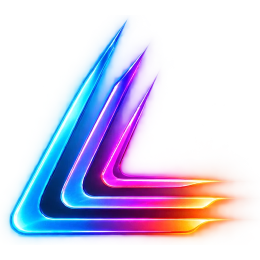
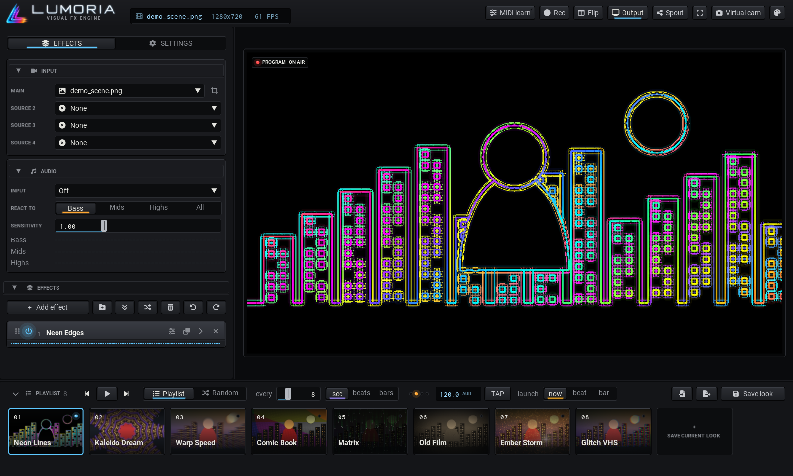
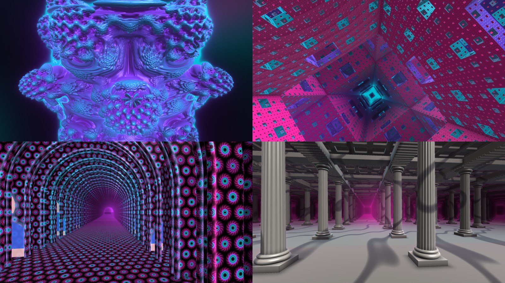
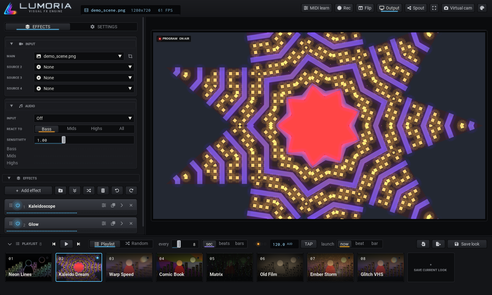

<p align="center"><br>
</p>

<p align="center"><b>Visual FX Engine</b>: real-time GPU video effects for streams, music and live visuals.</p>



Lumoria takes your camera, a screen, a window or a video, runs it through a chain of GPU effects that react to
your music, and sends the result to OBS (Spout, window capture or the OBS Virtual Camera) or straight to a video
file. Build looks, line them up in a playlist and fire them live, on the beat.

## Features
- **74 GPU effects**: neon edges, kaleidoscope, mirror slice, pixel sort, stained glass, oil paint, tiny planet,
  glitch, datamosh, tracers, time grid, film looks, colour grading, visualizers and more, stacked in any order,
  each with its own music switch.
- **3D worlds**: fly endlessly through fractals (Menger sponge, Mandelbulb, Mandelbox, Apollonian lace...), down
  infinite halls of arches, columns or visionary alcoves with you in them, through shattering glass, a spectrum
  city, liquid metal and more, all lit, fogged and moving with the music.
- **Automation on any slider**: waves, endless Spin, an Intro that glides in when a look starts and then keeps
  moving, positions that float, drift or hop on the beat, or follow any part of the sound.
- **AI person cut-out** (Robust Video Matting on the GPU): put effects on you, on the background or both; erase
  or replace the background; cut people out of several sources onto one scene.
- **Interactive effects** that react to your movement: smoke, flames, water ripples, light painting, settling
  snow, pin art, touch-to-pop bubbles.
- **Person effects**: echo clones of you trailing in time, hologram, aura, and disintegrating into dust or embers.
- **Music-driven**: follows any input or *what you hear* on the PC; a beat clock from the audio, tap tempo,
  manual BPM or MIDI clock from your DAW; timing in seconds, beats or bars.
- **Looks and playlist**: save whole setups as looks, crossfade or morph between them, auto-play by time or
  beats, import and export looks to share.
- **Sources**: cameras, video files, images, whole screens and single windows at 30 or 60 fps, cropped and
  placed anywhere, each with its own effects.
- **Outputs**: Spout (full quality, straight from the GPU, transparency included), an output window for OBS
  window capture, the OBS Virtual Camera, and recording to MP4 / MOV with sound on the graphics card's encoder.
- **Made for performing**: MIDI learn for any control, undo / redo, crash recovery, themes and a console-style
  interface. MIDI learn covers each effect's Scale, Rotate and Centre (click the left half of Centre for x, the
  right half for y) and its music note. Click a slider's Automate button, or right-click the slider, to link a
  button that pauses and resumes its automation without losing the settings. *Settings > MIDI > Button lights*:
  tick a controller and its linked buttons light up to match. Lumoria echoes the button's own note or CC, which
  works on controllers like the MIDI Mix.





## Download
Get the Windows installer from the [Releases](../../releases) page. No admin rights needed; your looks and
settings live in `%APPDATA%\Lumoria` and survive updates. After installing, *Lumoria Self-Test* in the Start menu
checks your PC (graphics, AI mask, capture, recording) and writes a short report.

**Needs:** Windows 10 or 11 (64-bit) and a graphics card with OpenGL 3.3 and DirectX 12 (anything from the last
several years: NVIDIA, AMD or Intel). OBS Studio is optional; the Spout2 plugin for OBS gives the best quality.

## Getting it into OBS
- **Spout (best quality):** press **Spout** in Lumoria's top bar, then in OBS add a *Spout2 Capture* source
  (from the [Spout2 plugin for OBS](https://github.com/Off-World-Live/obs-spout2-plugin)) and pick *Lumoria*.
  Full resolution straight from the graphics card, and a transparent background (the *Background* effect set to
  *Transparent*) stays transparent.
- **Window Capture:** Add Source → Window Capture → *Lumoria Output*, capture method *Windows 10 (1903 and up)*.
  Keep the output window open (it can sit behind other windows, just not minimised).
- **Virtual cam** (top bar): for Discord, Zoom and browsers, through the OBS Virtual Camera device (installed
  with OBS). Don't also press OBS's own *Start Virtual Camera*.

## Recording
**Rec** in the top bar (or `R`, or a MIDI pad: *Record on / off*) records the output to a video file, with a running
timer on the button. Settings > Output picks the format (*MP4 (H.264)*: plays and edits everywhere; *MP4 small*:
a third of the size; *MOV for editing*: MJPEG frames + uncompressed sound, large), the rate (30 / 60 fps), *Sound*
and the folder (default Videos\Lumoria). *Sound* records the audio input picked under Audio into the same file
(use Voicemeeter or a loopback input to record what you hear). The file plays back at real speed even if Lumoria
dips below the recording rate. Writing happens in a small helper process with the graphics card's own encoder
(NVENC / AMF / Quick Sync, else Windows or x264), so recording doesn't slow the show; it starts about 0.2 s after
the press while the encoder starts. Transparent backgrounds aren't kept in recordings (use Spout into OBS).

## First run
A welcome window helps pick a camera and gives a five-line tour; a new install starts with 8 sample looks
(Neon Lines, Kaleido Dream, Warp Speed, Comic Book, Matrix, Old Film, Ember Storm, Glitch VHS) in the playlist.
They live in `samples/`; the welcome (Settings > About > Show the welcome again) can add any that are missing.

## The layout
- **Top bar:** *File* (new, save, import, export, recordings folder, shortcuts) and *Settings* at the left; the
  readout in the centre (source, resolution, fps, CPU and GPU load); keys for MIDI learn, Rec, Flip (preview only),
  Output window, Spout, fullscreen and Virtual cam at the right. In a narrower window the bar gets taller instead of
  cutting things off: the readout moves to the right-hand corner with the keys under it; narrower still, the keys
  become small icon keys (hover one for its name) stacked in rows in the corner, and the source's name in the readout
  is shortened.
- **Settings** (top bar) drops down a short menu of its sections (Person detection, Tempo, Transitions, Output, MIDI,
  Interface, About), all folded. Click one and it opens in a panel to the right of the menu; clicking another
  switches to it (one is open at a time), and clicking the open one again folds it. Esc or a click outside closes
  Settings.
- **Sidebar:** Input, Audio, Effects, Transitions, Output.
- **Effects:** *+ Add effect* opens the library (searchable, grouped). Each effect in the chain is a card:
  drag it by its grip or its name to reorder, power to bypass, the **music note** turns listening on (lit) or off (dim; off, the
  music doesn't touch the effect at all),
  the arrow opens its settings (amount, opacity, blend mode, centre, speed and its own options), × removes it.
  The ⧉ button (or right-click > *Duplicate*) adds an independent copy ("Neon Edges 2") with the same settings,
  e.g. to run one effect on the subject and a differently set copy on the background. Copies save with looks.
- **Outline view (the default):** the list button on the Effects tab (or *Interface → Effects view*) turns the cards into a short
  list of the whole chain in order: power, name, mode, pin and remove on each row, with a thin live amount line.
  Click a row to open that effect: beside the list when the sidebar is wide (the list stays in view and scrolls
  on its own), or right under its row when it's narrow (*Interface → Open effects* forces either). It closes the one before (Shift-click, or the pin on a row, keeps
  several open; *Interface → Opening one* can make "keeps others" the default). Drag a row (by its grip or anywhere
  on it) to reorder, right-click for the card menu, number keys still follow the list order. Groups show with their
  effects indented under them.
- **Reordering effects:** while you drag, the effect lifts out and the others slide aside to open a gap where it will
  land; let go anywhere and it drops into that gap (Esc cancels). In the outline, where a group's rows end, drag a
  little to the right to land at the end of the group, or to the left to land after it; dropping just under an empty
  group's row puts it inside. On cards, drop on a group card's middle to put the effect in it (the group lights up).
  The list scrolls when you drag near its top or bottom.
- **Playlist (bottom):** saved looks as tiles. A look is a snapshot of the whole effect chain: build one in the
  sidebar, then press **Save look** (or the **+ Save current look** tile). Click a tile to fire it (with the current
  transition), drag to reorder; the ▾ key in a tile's lower-right corner (or right-clicking the tile) opens its menu:
  cue, transition & stay, timeline, overwrite, export, update thumbnail, delete. Play runs through the playlist (or
  random looks) every N seconds, beats or bars (the *every* button beside Playlist / Random). Switching looks (by clicking or auto-play) is a real crossfade: the old look keeps
  running while the new one comes in. The sidebar's *Transitions* sets the default; a tile's menu >
  *Transition & stay* opens the look's editor on that tab, to give it its own transition (Dissolve / Grow / Cut /
  Wipe / Flash / Morph) and time, plus how long auto-play stays on it (whole loop passes, for a look with a
  timeline). Its other tab is the look's *Timeline*.
  **Import / Export** (playlist bar) share or back up looks as files: *Export* saves the whole playlist to one
  `.lumoria-playlist`, right-click a tile > *Export this look* saves one `.lumoria-look`. *Import* adds the looks
  in such files to the end of your playlist (with their transitions and timing); a name you already use gets
  a number, so nothing is overwritten. Looks don't include sources, so they work on anyone's setup.
- **Sources:** *Input* has the main source plus Source 2-4 (cameras, video files, images, screen capture).
  Screens and windows capture at 30 or 60 fps. Capture uses DXGI desktop duplication (the same method as OBS's
  Display Capture: very little CPU), so a full 1440p screen keeps up at 60. Windows have *Fast* (cut from that
  screen capture, so keep the window visible) or *Behind others* (keeps working while covered, slower for big
  windows). The self-test reports whether fast capture works on a PC; where it doesn't, capture falls back to the
  older way (about 30 fps).
  Add a *Media Layer* effect (Sources) to put one into the chain: Fill / Fit inside / Stretch, size, position
  (Centre or Pick), rotation, rounded corners, neon border, and *Show: Person only (AI)* to place just the person
  from that source (its own person mask). Fill + *Apply to: Background* puts a video behind you (that uses the
  main source's mask: where *you* are); inside a group it can have its own effects. Sources are remembered
  between launches.
  To give one video its own effects without touching anything else, set a group's *Start from* to that
  source (Source 2-4): its effects then work on that video alone, and the group places the result in the
  picture with Size / Fit / Position (Pick) / Rotate / Rounded / Border, like a Media Layer.
- **Person mask and Person detection:** the AI finds the person in a source (the *person mask*). It changes nothing
  by itself; it's what the *Background* effect (replace or remove the background), every effect's *Apply to*,
  Tracers, Neon Edges' person outline, a source group's *Cut out person* and a Media Layer's *Person only* use.
  - Each source in the Input card has a **person button** beside it: *Auto* (the default: the mask runs only while
    something needs it, and the button lights while it does) or *Off* (never, e.g. for a screen or game with nobody
    in it; anything that asks then treats the whole picture as the person). Each of Sources 2-4 has its own mask,
    for its source group or Media Layer.
  - *Settings → Person detection* sets how the masks are made, for every source: quality (Fast / Balanced / High /
    Max), Edge refine (a guided filter that snaps the AI's edge onto the real edges in the picture), Stability (less
    edge flicker) and the captured background. *Show mask on preview* helps tuning.
- **Auto-save:** the current setup is saved every few seconds and on exit (`presets/_session.json`) and comes
  back on the next launch, including after *Update ready - restart*. Save a look to keep a setup permanently.
- **Resizing:** drag the lines between panels; *Interface → UI size* (or Ctrl + mouse wheel) scales all text and
  controls. The layout is remembered in `ui_settings.json`.
- **Themes:** *Settings → Interface → Theme* picks a theme (Console, Neon, Midnight, Analog, Carbon, Forest,
  Phosphor, Ember, Plum), and *Lights* the main light colour. A card that's on tints its header strip with a little
  of its light colour (blue manual, amber audio, violet wave and groups).

## Logo files
`assets/svg/` holds the Neon logo as vector art: the symbol with glow, flat and one-colour, the app icon tile (and a bolder
small one for 16-32 px), and the wordmark in white and gradient. `python assets/make_logo.py` draws them all from one
set of shapes and renders them as `assets/*_neon.*`. The original artwork keeps the plain names (`lumoria.ico`,
`lumoria_icon.png`, ...) and is what Lumoria (top bar, welcome, window and taskbar icon) and the installer use; the
Neon set is kept as artwork only.

## Audio react
Pick an input under *Audio* (it's remembered for next time). To follow music playing on the PC, pick an output
under *What you hear* at the bottom of the list (Windows' default output first): Lumoria listens to what that device
plays, like OBS's Desktop Audio, with no extra software. A loopback input (e.g. *Loopback Mix (MOTU M Series)* or
a Voicemeeter Out) works too. Effects with their **music note** lit follow the chosen band; recordings take their
sound from the same input. Audio and 3D effects choose what the music does in their own settings (*Breaks on*,
*Music moves*...), so those settings work whether the note is lit or not.
Beat effects (Glitch *On the beat*, Bubbles *Pop on beat*, Datamosh *On the beat*, visualizer rings, Neon
Shapes' beat pulse, *Audio* colour motion) follow the bass beat; with no input they tick at 120 BPM.

## Audio on any slider
Click the wave button at the end of any slider's row (or right-click the slider) and choose *Shape: Audio* to make
it follow the music; the button lights magenta. The menu has:
- **Listens to:** Bass / Mids / Highs / All, the drums (Kick, Snare, Hats, Big kicks), the tempo Beat, or a
  **frequency range** you pick on the live spectrum (e.g. only the vocals).
- **Slow and stereo measures** (for subtle, always-moving influence, alongside the drum hits): *Energy* (slow
  loudness: builds and drops, relative to the track's own range), *Brightness* (dark to bright sound), *Busyness*
  (how much is changing), *Pan* (where the sound sits, left to right: 0.5 is the middle) and *Width* (mono to wide
  stereo). Energy, Brightness, Busyness and Pan are also in the Audio card's *React to* row.
- **Feel:** one-click starting points: *Subtle* (a slow swell), *Punchy* (quick and snappy), *Hit* (only loud hits,
  then it drops away fast).
- **Response:** the main smoothing, or your own **attack** and **release** times.
- **Sensitivity, Threshold, Curve:** how loud the sound must be to move it, and whether quiet sounds count more
  (curve left: subtle, always moving) or only loud ones do (curve right: dramatic).
- **From / To:** the slider's range, so a small range is subtle and a full range is dynamic.
- Live **Hearing** and **Moving it** meters show what it hears and what it drives.

Different sliders on one effect can follow different sounds: the kaleidoscope's zoom on the hats, its rotation on
the bass. Settings are saved with looks.

**Drum hits:** the Audio card has a sensitivity for each drum, *Kick hits*, *Snare hits* and *Hat hits*: how easily
that drum counts as a hit (low: only the clearest, high: every little one). They're separate, so you can raise the
hats until quiet ones light up without the kick getting jumpy; watch the hit lights under them while you set them.
How each is told apart from the rest of the mix:
- **Kick:** the low thump and the pitch sweep coming down through 120-250 Hz, together, on the plain loudness. A
  bassline's new notes rise in the low end as much as a kick but hardly in the sweep's range, so they don't count
  (808-style kicks with little sweep still do). A kick also has to be a good part as strong as the recent ones.
- **Snare / clap:** its crack (1.5-5 kHz). A kick's click reaches up there too, so right on a kick only a crack
  nearly as big as the recent snares counts (a real snare on the same beat still does).
- **Hats:** the top end (7-14 kHz) jumping more than the snare's range does; fainter hats count than before.

A session saved with the older single *Hit sensitivity* loads with all three set to it.
*Smoothness* sets how gradually audio-driven effects rise and fall: 0 is quick and percussive, 1 is slow and flowing (good for ambient music).
Effects that follow the sound have a **Music** setting: *Reactive* (follows it as it happens), *Swell* (breathes with how loud it has
been), *Flow* (drifts on a clock that speeds up with the music) or *Rhythmic* (moves in time with the beat), plus a *Response* slider for
how slowly they answer. Aurora Field, Stained Glass and Audio Warp animate their inner structure this way.
**Affects: Chosen.** Under *Apply to*, any effect can be set to work on only what chosen effects above it contributed. Tick Aurora Field under Audio Warp and the warp bends the aurora while the video stays still. Overlay and audio effects contribute the light they add; other effects contribute their whole change, so it works best with movement effects. The chosen effect feeds into the one that picked it, and its card says so.
Overlay effects (Light Rays, Light Leaks, Bubbles, Neon Shapes, Audio Visualizer, Aurora Field, Spectrum Terrain, Vectorscope) have shared
**Scale** and **Rotate** about their Centre; the picture underneath stays put.
Every wide slider also has a number box beside it for typing an exact value (Settings > Interface > Number boxes).

## Automation: sliders that move on their own
The same wave button (lit cyan while it moves) offers, besides Audio:
- **Waves:** Sine, Triangle, Ramp up / down, Square, Random steps, Smooth random, every so many seconds, beats or bars.
- **Spin:** keeps going one way forever. On *Rotate* it turns in whole turns without ever jumping back.
- **Intro:** when the effect comes on (or its look loads) it glides *From* → *To* over the time you set, with an ease;
  then it holds, or hands over to a wave between *To* and *Then to*. Shard Storm shattering out of the picture and
  staying broken is an Intro on *Scatter*.
- **Floating position:** on the *Centre* of any effect that has one: Drift, Orbit, Figure 8, Bounce or Hop on the
  beat, with a size and speed. Moving the Centre by hand moves the point it floats round.

## Tempo
One beat clock drives beat effects, auto-play and look timing (Settings > Tempo; live in the playlist bar).
Source: **Audio** locks to the music's own tempo and beat. It needs a few seconds to settle, then keeps steady time
through quiet parts. If the beat feels twice too fast or too slow (drum & bass, trap), set *Feel* to Half time or
Double. **Tap** (`T`, the TAP button or a MIDI pad),
**Manual** BPM, or **MIDI clock** from a DAW (send clock to a MIDI port Lumoria can see; for a DAW on this PC a
virtual port such as loopMIDI; Start = beat 1). `B` makes the current beat beat 1 of the bar. Transition times,
a look's stay time and the auto-play interval can be in **seconds, beats or bars**. **Launch** (now / beat /
bar / 4 / 8 / 16) makes a fired look wait for the next beat, bar, or 4, 8 or 16-bar phrase, with a countdown on
its tile. Phrases count from beat 1, so press `B` on a downbeat if they land in the wrong place.

## Cue, Take and the crossfader
Beside the look tiles: **Shift-click** a tile (or right-click > Cue, or `Up` / `Down`) to line a look up without
firing it. **Take** (`Enter`) brings it on with its own transition, on the Launch beat, bar or phrase. You can also
fade it in by hand with the **crossfader**: slide it toward the cued look and the picture blends as you go. At the
far end the cued look is on air and the fader's ends swap, so the next cued look comes in on the way back. Morph
and Cut looks fade as Dissolve under the fader. Take mid-fade finishes the fade from where the fader is. Firing
another look, or cueing a different one, puts the on-air look back. MIDI learn covers the crossfader, Take and
Cue next / previous; with Button lights on, Take lights up while something is cued.

## Look timelines
A look can have a **timeline** that moves its sliders over time, in bars on the tempo clock (or seconds). Open it
from a look tile's ▾ menu (or right-click) > **Timeline...** (the look's editor, beside its *Transition & stay*
tab); *Make a timeline* gives it one, 8 bars long.
- **Lanes:** *+ Lane* picks an effect in the look and one of its sliders (the same ones its card can automate).
  Click a lane to add a point, drag a point to move it (it snaps to the *Grid*; hold Shift to place it freely),
  right-click a point to choose how it gets to the next one - *Ramp* (a straight line), *Ease* (smooth in and out)
  or *Hold, then jump* - or to delete it. The eye mutes a lane, × removes it. A slider with a lane follows the lane,
  not its wave; its Automate button turns into a violet timeline mark.
- **Value or depth:** the button left of the eye switches a lane between *value* (it sets the slider) and *depth* (it
  sets how far the slider's wave swings, 1 = its whole From-To range, 0 = still in the middle) - e.g. a wave that's
  subtle in the intro and wide by the drop. A depth lane needs a wave on the slider (its Automate button).
- **Editing many points:** Ctrl+click or Ctrl+drag a box selects points (in any lanes); drag one of them to move them
  all, Delete removes them, Ctrl+C / Ctrl+V copies and pastes them at the mouse (one lane's points can go into
  another lane, scaled to its slider), Ctrl+A selects every point, right-click sets the segment of all of them.
  Ctrl+Z / Ctrl+Y undo and redo timeline edits while the editor is the window you're in.
- **Zoom:** Ctrl + wheel over the lanes zooms, Shift + wheel scrolls, *Fit* shows it all again.
- **From an Intro:** a slider whose wave is an *Intro* (From -> To once) shows "(from its Intro)" in *+ Lane*: that
  draws the Intro as a lane you can then reshape.
- **On the tiles:** a look with a timeline shows a timeline mark; while it plays, which section it's in and its loop
  pass. The **Outro** key beside Take (and a MIDI pad: MIDI learn, then click it) makes the look leave through its
  outro now, into the cued look or the next one.
- **Taking over:** grab a slider that a lane moves - on its card, or with its MIDI control - and it's yours until the
  lane's next point (or the end of the section playing), then the lane takes it back.
- **Intro / loop / outro:** drag the two markers on the ruler. The intro plays once when the look comes on, the loop
  repeats while it stays on, and the outro plays when it leaves. *Whole loop* (no markers) just repeats.
- **Leaving:** Take, a tile click, previous / next, MIDI and auto-play all wait for the outro. *On leave: Finish the
  pass* plays the loop to its end first; *Jump to outro* starts it at once (timed to end on the launch beat, bar or
  phrase when *launch* is set). The next look comes in so its transition overlaps the end of the outro, while the old
  look plays its outro out as it fades. The crossfader, random auto-play and firing the same look skip the outro.
- **Auto-play** stays on a timeline look for whole loop passes: *Stay* on the *Transition & stay* tab sets how many
  (0: as many as fit the playlist's *every*).
- The timeline is saved in the look, so exporting and importing a look keeps it. Changes save as you make them, and
  if the look is on air you see them straight away, with the playhead moving across the lanes.

## Mirror Slice
Mirrors the picture (left-right, up-down or both, as a 2x2 grid), cuts it into strips and lays them outside-in
(1, last, 2, second-to-last...), first across, then down: a live version of the Mirror Slice image tool. *Columns*
and *Rows* (2-120) set the strips, *Density* scales both (so the music switch or an automation makes it breathe), *Gaps* draws
dark lines between strips. *Slice* can cut up the whole picture, only you (over the picture or over black; with a
captured background the unsliced you is erased underneath) or only the background while you stay whole.
*Motion*: still, a new density on every beat, or drifting cut lines (Speed).

## Person effects (Cutout)
Built on the AI mask:
- **Echo Clones:** copies of you a little further back in time each, beside you (both sides, right, left) or
  behind you shrinking into the distance. *Spacing* (the main slider; the music switch or an automation makes the line breathe),
  *Copies* (1-7), *Delay*, *Fade*, *Tint* with any palette.
- **Hologram:** you as a tinted, scanlined projection with flicker, glitch tears, a glowing edge and a projector
  beam (drag the centre point to move its base). *Behind you*: the room (the captured background if there is one),
  a dark room or black.
- **Aura:** a glow streaming off your outline (*Rising*, *Radiating wisps* or a *Soft halo*) that pulses with the
  bass, in any palette and colour motion.
- **Disintegrate:** you crumble into dust, embers or pixels that drift up, sideways, down or outward and come
  back. *Drive*: a loop, the Progress slider (handy on a MIDI fader) or out and back over two bars.

## More looks
- **Pixel Sort:** runs of bright or dark pixels, you, the background or everything sorted into streaks by
  brightness, hue or saturation, in any direction.
- **Stained Glass:** the picture as glass cells with lead between them (dark, gold, white or glowing); still, a new
  pattern on every beat, or drifting cells.
- **Oil Paint:** brush-stroke painting (Kuwahara filter) with canvas texture and outlines, or *Watercolour*.
- **Tiny Planet:** the picture wrapped into a little world with you standing on top, or a tunnel; Twist and spin.
- **Time Grid:** tiles each showing a moment further back (2x2 to 4x4), whole pictures or each tile its own part
  of the frame, in reading order, from the centre out or shuffled on the beat.

## Audio visuals
The *Audio* category (with the Audio Visualizer) visualizes the sound on any picture, or none. They don't need the AI
cut-out, and each has its own palette and colour motion:
- **Spectrum Terrain:** the spectrum's recent past as rows of ridges receding into the distance, newest in front
  (ridge lines or solid terrain), over the picture, a darkened picture or black. *Scroll speed* sets how fast time
  flows.
- **Vectorscope:** the stereo sound drawn as light, left against right: a vertical line for a mono sound, a swirling
  cloud for a wide mix, with an afterglow like a real scope.
- **Audio Warp:** the picture bends with the music: the spectrum bounces its columns, the bass pumps and tilts it
  (with the pan), and every kick, snare and hat sends a ring rippling out (optionally from three different spots),
  with a colour split on the highs.
- **Picture Spectrum:** spectrum bars made of the picture itself: bars from the bottom, mirrored from the middle, or
  radial, with the rest black, dim or the picture.
- **Aurora Field:** a flowing field of colour driven by the music's slow side: Energy swells it, Brightness shifts its
  colour, Busyness stirs it, the Pan leans it left or right, and every kick flares it (curtains, nebula or ribbons).

All of them answer to the drum hit sensitivities and the audio input chosen on the Audio card, and their sliders can follow
the sound too (the wave button at the end of a slider's row).

## 3D effects
The *3D* category builds real 3D scenes with depth, lighting, fog and a moving camera. Each has Centre, Scale and
Rotate to place it, and the raymarched ones have *Smoothing* (Off, 2x, 4x or Over time) to keep fine detail from
shimmering. What the music does is chosen in each effect's own settings, off by default except where it's the point.
- **Fractal Flight:** Sponge tunnels, Menger cube, Mandelbox, Mandelbulb, Octahedral sponge, Kaleido star,
  Apollonian lace and Crystal lattice, flown through, orbited, drifted or dived into. *Dive in* on the sponges is an
  endless fall down a tunnel that keeps opening into smaller tunnels. *Variation* and *Morph* turn the folds steadily
  one way and come back round to the start, so they can spin forever; *Dance* makes the small forms ripple like
  vibrated ferrofluid; your picture can cover the walls.
- **Infinite Halls:** arches, a square tunnel, a Roman colonnade in every direction, or a visionary hall of nested
  arches with you in glowing alcoves; walls of your picture, marble, gold, eye cells, squiggles or chrome hex; a
  doorway at the far end looking out into your picture.
- **Shard Storm:** the picture as a pane of glass, whole at rest, cracking and breaking out on the kicks and
  settling back (shatter, vortex, warp stream or swarm).
- **Spectrum City:** the last few seconds of the music as a lit city of bars, a circle, or a valley you look down.
- **Picture Object:** a cube, sphere, torus, any of the five platonic solids or a twisted pillar, wrapped in your
  picture, a window onto it, chrome or glass, over a mirror or neon floor.
- **Liquid Metal, Pin Field 3D, Voxel You, Flip Wall, Warp Tunnel, Picture Orb.**

## Interactive effects
The *Interactive* category reacts to you, through the AI mask (Source: Person) or anything moving in the
picture (Source: Any movement): **Particles**, **Smoke** and **Flames** (a small fluid your movement stirs),
**Water Ripples** (a wave simulation, with rain or beat drops), **Light Painting** (movement or bright lights
leave glowing strokes), **Snow That Settles** (snow / ash / petals pile on you and slide off when you move),
**Pin Art** (a pin field showing the picture, bulging away from you), and Bubbles' *Ending: Pop when touched*.

## Colours
Every effect with a colour choice uses the same palettes: Rainbow, Neon cyan / magenta, White, Source colour,
Synthwave, Vaporwave, Fire, Ice, Toxic, Sunset, Ocean, Gold, Terminal green, and **Custom** (swatches appear
under the dropdown: click one to pick a colour, **+** / **−** to use 2 to 8 colours, right-click a swatch to remove
it). *Colour motion*: Static, Cycle (through the palette over time), Flow (moving across the picture), Audio
(shifts with the music), Radial (rings outward), Spiral, Rise (bands moving up), Breathe (everything swings
together), Beat jump (next colour on each beat) or Drift (slow wandering blobs).

To grade the picture itself (Colour category): **Colour Adjust** has Brightness, Contrast, Saturation, Hue, Warmth
and Shadows (each 0 = unchanged; double-click a slider to type a value), and **Film Looks** has one-click styles
(Sepia, Black & white, Noir, Vintage, Old film, Polaroid, Teal & orange, Bleach bypass, Cross-process,
Technicolor, Cool blue, Golden hour, Lomo, Cyberpunk, Infrared, Night vision) with Grain, Vignette and Fade.
Strength blends either one with the original.

## Keys (control window)
`F1` shows them all in the app.
- **Looks:** `←` / `→` (or `N`) previous / next · `Shift`+click a tile to cue it · `↑` / `↓` cue previous / next ·
  `Enter` Take · `Home` / `End` first / last · `Space` play / pause the playlist ·
  `Delete` delete the highlighted look (asks first: `Enter` deletes, `Esc` keeps it) · `Ctrl+S` save the chain as
  a new look · `Ctrl+I` / `Ctrl+E` import / export looks
- **Effects:** `1`–`0` toggle the first ten effects · `X` randomize · `C` clear · `Ctrl+Z` / `Ctrl+Y` undo / redo
- **Tempo:** `T` tap · `B` this beat is beat 1 of the bar
- **Output:** `R` record on / off · `O` show / hide the output window · `F11` output fullscreen (also double-click
  the output window; `Esc` exits) · `M` flip the preview

## Adding effects
Effects are GLSL fragment shaders in `effects.py`; add a dict to `EFFECTS` (and a category in `_CAT`)
and it shows up in the library with its sliders and dropdowns.

## Building from source
Lumoria is Python. With Python 3.14 (64-bit) on Windows:

```
python -m venv .venv
.venv\Scripts\pip install -r requirements.txt
.venv\Scripts\python app.py
```

(`run.bat` starts it too.) Running from source keeps looks and settings in the project folder (`presets/`,
`ui_settings.json`, `midi_map.json`), which `.gitignore` keeps out of git.

`.venv\Scripts\pip install pyinstaller` and then `.venv\Scripts\python build.py` build `dist\Lumoria\Lumoria.exe`
(PyInstaller) and, if Inno Setup 6 is installed, `installer\Lumoria-Setup-<version>.exe` (Start menu, optional
desktop icon, uninstaller; no admin needed). The version is `VERSION` in `shared.py`. The installed app keeps
looks, settings and MIDI links in `%APPDATA%\Lumoria` (kept on uninstall). Check a build with `Lumoria.exe --selftest`: it runs a few seconds with the AI mask, an effect and Spout
on, writes `%TEMP%\LumoriaSelftest\selftest.json`, and quits, without touching your own looks.

Tests: `.venv\Scripts\python -m unittest discover tests` runs the automated checks (safe saving, look and playlist
imports including damaged and hostile files, crop cleaning, background removal recovering from errors). They run on
a throwaway data folder, never your own looks.

## License
Lumoria is open source under the [GNU General Public License v3.0](LICENSE): you can use it, share it, change
it and sell it, as long as what you pass on stays under the same licence with its source available. The AI mask
model (Robust Video Matting, see `models/README.md`) is GPL-3.0; the x264 encoder bundled through PyAV is GPL;
everything else Lumoria builds on is under permissive licences (listed in Settings > About).

## Support
Lumoria is made by one person. If it's part of your shows or streams, buying the installer or a tip helps keep
it going.
